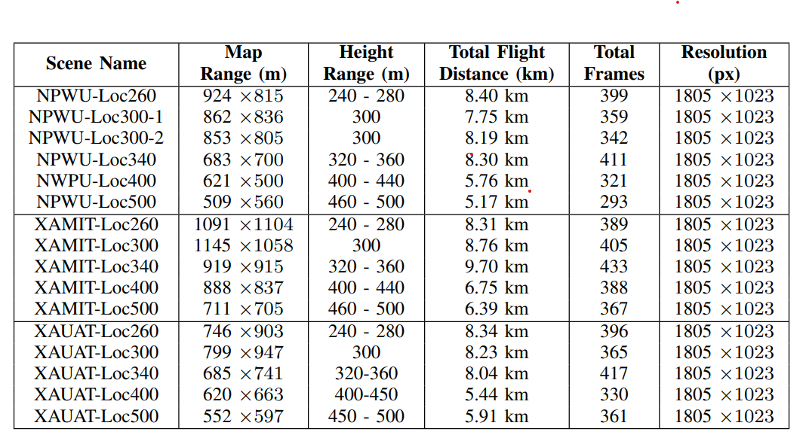

# LD3DGS-SLAM: Long-Distance Monocular SLAM with 3D Gaussian Splatting and GNSS-Aided Localization for UAVs

[](https://ieeexplore.ieee.org/document/11271491)
[](https://pan.baidu.com/s/1jlvAZRLa9byTfmDx0dF9mw?pwd=suk9)
[](./LICENSE)

> **Official repository for the paper:**  
> *LD3DGS-SLAM: Long-Distance Monocular SLAM with 3D Gaussian Splatting and GNSS-Aided Localization for UAVs*  
> **IEEE Internet of Things Journal**, 2026, 13(4): 7320–7340.

---

## 📌 Abstract

Integrating neural rendering with simultaneous localization and mapping (SLAM) has shown great promise for achieving high-precision localization and photorealistic scene reconstruction. However, the dynamic perspectives of uncrewed aerial vehicles (UAVs), compounded by Global Navigation Satellite System (GNSS) signal interference and the accumulation of localization errors, pose significant challenges to existing monocular SLAM methods in complex environments. To address these limitations, we propose **LD3DGS-SLAM**, a novel framework that integrates monocular SLAM, GNSS, and 3D Gaussian splatting (3DGS) to enhance UAV-based localization and mapping.

The system integrates traditional geometric feature-based localization with the multiview synthesis capability of 3D Gaussian rendering, achieving a breakthrough in accuracy while enhancing robustness. First, we construct a multisensor fusion graph optimization model that tightly integrates GNSS and monocular vision data, effectively mitigating the cumulative drift typical of traditional SLAM pipelines. Afterward, we introduce a 3D Gaussian-based mapping strategy that incrementally refines a dense scene representation using SLAM-generated point clouds, fusing geometric and texture information to reconstruct highly accurate and detailed maps. To further enhance localization performance in GNSS-denied scenarios, we develop a dynamic frame interpolation and tracking approach based on 3D Gaussian rendering. By synthesizing novel viewpoints, this method improves observation matching and strengthens loop closure detection, enabling robust relocalization in large-scale environments.

Experimental results show that LD3DGS-SLAM achieves a state-of-the-art average localization error of only **0.8 meters** using just a monocular camera, even during long-range flight missions exceeding tens of kilometers and altitudes up to 500 meters.

---

## 👥 Authors

| Name | Affiliation |
|------|-------------|
| Dongdong Li | <sup>1</sup> |
| Tao Yang | <sup>1</sup> |
| Yilin Wang | <sup>1</sup> |
| Haidong Qin | <sup>1</sup> |
| Shixiong Fan | <sup>1</sup> |
| Shuanghan Zhang | <sup>2</sup> |
| Yidan Zhang | <sup>2</sup> |
| Jing Li | <sup>2</sup> |

<sup>1</sup> Primary Institution  
<sup>2</sup> Secondary Institution

---

## 🔑 Key Contributions

- **Multisensor Fusion Graph Optimization**: Tightly couples GNSS and monocular vision to eliminate cumulative drift in long-distance UAV flights.
- **3D Gaussian Splatting Mapping**: Incrementally refines dense scene reconstruction from SLAM point clouds with fused geometry and texture.
- **Rendering-Based Relocalization**: Synthesizes novel viewpoints via 3DGS to improve matching and loop closure detection in GNSS-denied environments.
- **Large-Scale Aerial Dataset**: Provides a self-collected dataset spanning several kilometers with altitudes from 240 m to 500 m across three distinct scenes (NWPU, XAMIT, XAUAT).
- **SOTA Performance**: Achieves 0.8 m average localization error in flights exceeding 10 km at up to 500 m altitude using only a monocular camera.

---

## 📊 Dataset

### Dataset Overview

Our dataset consists of both public and self-collected data sources:

| Source | Description | Usage |
|--------|-------------|-------|
| **TUM** [2] | Public indoor small-scale dataset, monocular & RGB-D, no GNSS | Camera tracking & mapping comparison (small-scale indoor) |
| **Self-Collected (eVTOL)** | 30 km wide-area, 120 m altitude, fisheye camera, RTK GNSS | Evaluate accumulated error in long-distance monocular visual SLAM |
| **Self-Collected (UAV)** | Multi-altitude (240–500 m), high-res color, 3 scenes | Validate effective range & localization accuracy of the map |

### Data Showcase


*Figure 1: Overview of the self-collected aerial dataset covering three university campus scenes (NWPU, XAMIT, XAUAT) at multiple altitudes.*

### Data Information Table



*Figure 2: Detailed localization data information for NWPU, XAMIT, and XAUAT scenes.*


### Dynamic Dataset Description

The self-collected dataset includes dynamic objects (moving vehicles and pedestrians) and was captured across different time periods at three university campuses:

- **NWPU** (Northwestern Polytechnical University)
- **XAMIT** (Xi'an Aeronautical Institute)
- **XAUAT** (Xi'an University of Architecture and Technology)

Each scene covers schools, rivers, farmland, typical residential buildings, and roads, with data collected at altitudes ranging from 240 m to 500 m.

---

## 📥 Dataset Download

| Source | Link | Password |
|--------|------|----------|
| Baidu Netdisk | [Download](https://pan.baidu.com/s/1jlvAZRLa9byTfmDx0dF9mw?pwd=suk9) | `suk9` |
| Baidu Netdisk | [Download](https://pan.baidu.com/share/init?surl=K_MugPPtgDhICZgn3PFoyg&pwd=4bnd) | `4bnd` |


> **Note:** If you use this dataset in your research, please cite our paper (see below).

---

## 📖 Citation

If you find this work useful for your research, please cite:


```bibtex
@article{11271491,
author={Li, Dongdong and Yang, Tao and Wang, Yilin and Qin, Haidong and Fan, Shixiong and Zhang, Shuanghan and Zhang, Yidan and Li, Jing},
journal={IEEE Internet of Things Journal},
title={LD3DGS-SLAM: Long-Distance Monocular SLAM With 3-D Gaussian Splatting and GNSS-Aided Localization for UAVs},
year={2026},
volume={13},
number={4},
pages={7320-7340},
doi={10.1109/JIOT.2025.3638876}
}
```


## 📄 License

This repository and dataset are released for academic research purposes only. Please refer to the [LICENSE](./LICENSE) file for details.

---

## 🙏 Acknowledgements

We thank the IEEE Internet of Things Journal editorial team and reviewers for their valuable feedback. We also acknowledge the TUM dataset [2] for providing the public benchmark used in our evaluation.

## Contact
- [Team Introduction](https://robot-vision.net/) 
- [Personal Email](1051196347@qq.com)
